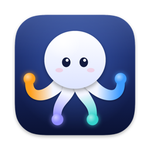
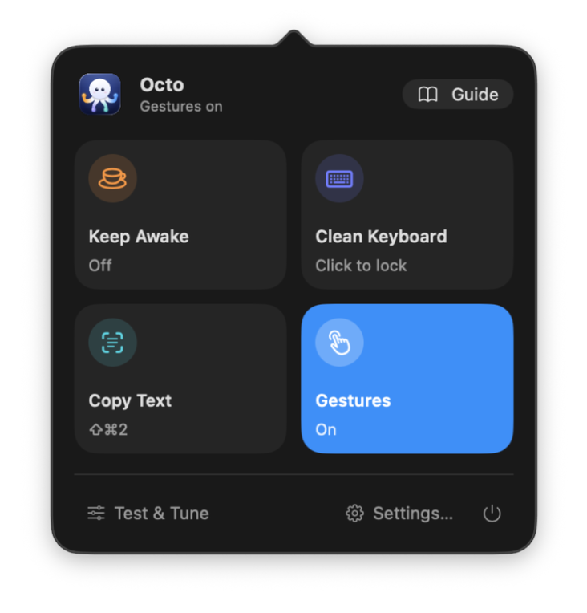
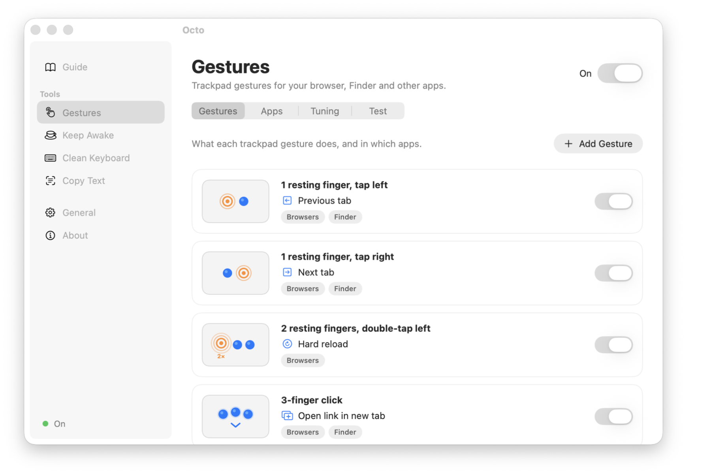

<p align="center">
  
</p>

<h1 align="center">Octo</h1>

<p align="center">
  Small tools for your Mac, in one menu bar app.<br>
  Trackpad gestures · Keep Awake · Clean Keyboard · Copy Text
</p>

<p align="center">
  <a href="../../releases/latest"><b>Download Octo</b></a>
  &nbsp;·&nbsp;
  <a href="https://ko-fi.com/tombonte">Support on Ko-fi</a>
</p>

<p align="center">
  
</p>

Click the octopus in your menu bar and every tool is one click away. Octo is free, open source,
and never connects to the internet.

<p align="center">
  
</p>

## What it does

### Trackpad gestures

Fast gestures for your browser and Finder, in the spirit of the much-missed Jitouch:

| Gesture | What it does |
|---|---|
| Rest one finger, tap to the left of it | Previous tab |
| Rest one finger, tap to the right of it | Next tab |
| Click a link with three fingers (a real press) | Open it in a new tab, in the background |
| Click a link with four fingers | Open it in a new tab and go there |
| Rest two fingers, double-tap to the left of them | Hard reload |

Change any of them, add your own (any keyboard shortcut, only in the apps you choose), and watch
your fingers live in the Test view while you get the feel for it. Octo ignores palms resting on the
edges and taps right after typing, so gestures don't go off by accident.

Learning them? Octo can show a small hint each time a gesture runs, and a live trackpad with your
fingers on screen, which is also handy for recording a demo (Settings → Gestures → Tuning).

<p align="center">
  <picture>
    <source media="(prefers-color-scheme: dark)" srcset="docs/settings-dark.png">
    
  </picture>
</p>

### Keep Awake

One click stops your Mac from going to sleep: for long downloads, presentations, or anything that
shouldn't stop halfway. Click again to let it sleep as usual.

### Clean Keyboard

Blocks keys, scrolling and swipes so you can wipe the keyboard and trackpad without typing or
clicking anything. Hold the on-screen button for a second to unlock (it also unlocks by itself
after 5 minutes).

### Copy Text

Press ⇧⌘2, drag a box over any text on screen, and it's copied: photos, PDFs, paused videos,
screen shares, error messages. A box around a QR code copies its link. Text recognition runs on
your Mac, offline.

## Install

1. Download the latest `Octo-….dmg` from [Releases](../../releases/latest).
2. Open it and drag **Octo** into **Applications**.
3. Open Octo from Applications. macOS says it can't verify the developer, because Octo isn't
   notarized by Apple (that needs a paid developer account). Click **Done**, open
   **System Settings → Privacy & Security**, scroll down and click **Open Anyway**. You only do
   this once.
4. Octo's Guide opens. Click **Allow Access…** and turn on Octo under Accessibility. Copy Text asks
   for Screen Recording the first time you use it.

**Requirements:** macOS 14 Sonoma or later, on Apple Silicon or Intel. Gestures need a trackpad
(built-in or Magic Trackpad).

**Updating:** download the new version and replace the old one in Applications. Your settings and
permissions stay.

## Privacy

- Octo never connects to the internet: no account, no analytics, no ads, no update checks.
- **Accessibility** lets Octo send shortcuts (like "next tab"), handle multi-finger clicks, and
  block keys while you clean.
- **Screen Recording** is only for Copy Text: Octo looks at the box you draw, only when you start
  it, and saves nothing.
- Your settings are one readable file: `~/Library/Application Support/Octo/config.json`.

## Good to know

- **A gesture fires twice?** Another gesture app (BetterTouchTool, Jitouch, MiddleClick) is
  probably running too. Octo warns you when it sees one.
- **Tap to click on?** A gesture tap could also click whatever is under the pointer. Octo removes
  that extra click (Settings → Gestures → Tuning).
- **Gestures stopped after a macOS update?** Octo reads the trackpad through a private part of
  macOS, like every gesture app does. If Apple changes it, gestures stop (the other tools keep
  working) until Octo is updated.

## Uninstall

Quit Octo (the power button in its panel), move it from Applications to the Trash, and delete
`~/Library/Application Support/Octo` and `~/Library/Logs/Octo.log`. In System Settings →
Privacy & Security, remove Octo from Accessibility and Screen Recording.

## Build it yourself

Only the Xcode Command Line Tools are needed (`xcode-select --install`), not full Xcode.

```bash
git clone https://github.com/tom-bonte/octo.git
cd octo
scripts/install.sh   # tests, builds, and installs into /Applications
```

[CONTRIBUTING.md](CONTRIBUTING.md) explains how Octo is put together and how to add a tool,
gesture or action.

## Support

Octo is free. If it saves you time, you can
[buy me a coffee on Ko-fi](https://ko-fi.com/tombonte). Bug reports and ideas are welcome
in [Issues](../../issues).

## License

[MIT](LICENSE) © 2026 Tom Bonte. Gestures inspired by Jitouch.
